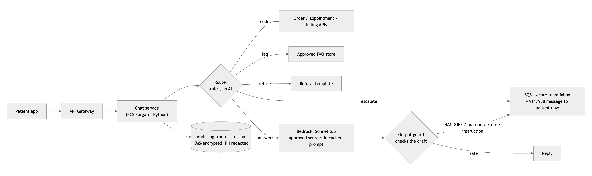

# Omzo Air: chat backend at launch

## 1. Architecture

App → API Gateway → one Python service on ECS Fargate (no Kubernetes; about 0.2 messages a second) in a BAA-covered AWS account; Bedrock via a VPC endpoint keeps health data in AWS.

1. The **[router](router/)** checks urgent rules first, so nothing hides an urgent message; four routes use no model.
2. Only `answer` calls the model, with approved sources in a cached [system prompt](system-prompt/omzo-air-system-prompt.md). It must cite them, and replies `HANDOFF` to anything risky the router missed.
3. An **output guard** escalates a `HANDOFF`, an uncited reply or a dose instruction. Reusing the urgent rules here flagged 25% of good answers [in testing](experiments/RESULTS.md), so it doesn't.
4. Escalations go to the care team's queue, and the patient sees 911 / 988 guidance at once.

## 2. Not built at launch

1. **Vector database / RAG:** the approved library (about 3k tokens) fits in a cached prompt.
2. **Personalisation from raw wearable data:** more tokens, health-data exposure and clinical risk.
3. **A care-team dashboard:** use their existing ticketing tool; spend the 12 weeks on safety.

## 3. Monthly model cost

525,000 messages a month (17,500 × 30) × (4,000 in + 300 out) tokens; Anthropic list prices per M tokens.

| Scenario | Per message | Monthly |
|---|---|---|
| No router, all to Haiku 4.5 ($1 / $5) | $0.004 + $0.0015 | $2,888 |
| **Chosen:** 60% to **Sonnet 5.5** ($2 / $10), 3k cached ($0.20) | $0.0006+$0.002+$0.003 | **$1,764** |
| + Haiku safety classifier on all messages | $0.0007 | +$368 |

Total about **$2.1k** of $3k (Bedrock rates to be confirmed). Haiku isn't cheaper here: the 3k prefix is below its 4,096-token caching minimum, so it costs about the same ($1,733) for a weaker model. Thinking is off; the 60% is a guess that week-1 logs replace.

## 4. Week 1

- AWS account, BAA, Bedrock access, KMS keys, logs with PII redacted.
- Router and evaluation as a CI gate: a missed urgent message fails the build.
- Clinician's day: sign off the urgent list and label about 200 messages for the evaluation set.
- Escalation path end to end (queue → care team → emergency message), before any AI answer.

## 5. What forces a redesign

**10× users (175,000 messages a day).** The model bill reaches about $21k a month against $3k, and at 5% escalation the care team gets about 9,000 escalations a day instead of 900. People, not compute, become the bottleneck. I'd grow the FAQ and code routes from the logs, use a cheaper answer model where the evaluation allows, and split escalation into "emergency now" and "next business day".
